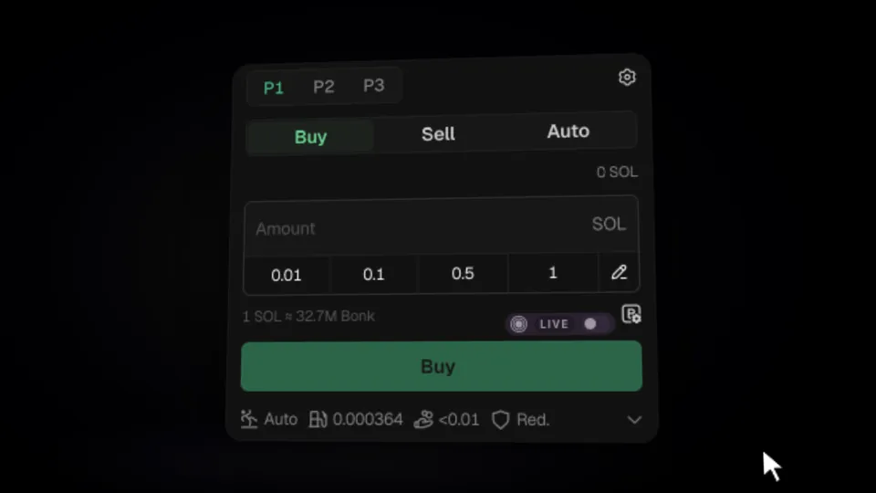

# Tradeasy

Chrome extension for trading on terminals with their own UI and presets, while trades are signed by the extension's wallet with your own configuration. No terminal fee, and Tradeasy charges nothing in its place. Your key never leaves your machine.



## Install

```bash
npm install
npm run build
```

Open `chrome://extensions`, enable Developer mode, choose Load unpacked and select `dist/`. The popup walks you through wallet and API key setup.
